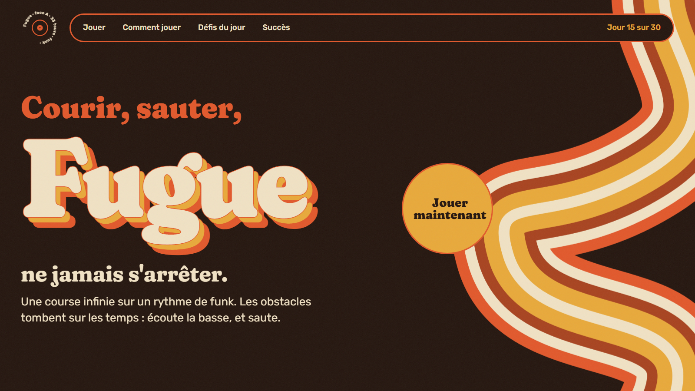

# Fugue · Courir, sauter, ne jamais s'arrêter

> Jour 15 du défi **30 jours, 30 projets** · JavaScript · Canvas · Web Audio · 🟢 **En ligne : [fugue.projectp.fr](https://fugue.projectp.fr)**



Une course infinie en 2D, habillée en pochette de vinyle des années 70. Le coureur part tout seul ; on saute, on glisse, et le tempo monte. **Les obstacles tombent sur les temps** d'une boucle de funk générée en Web Audio : la musique accélère avec la course, et chaque note suit la distance.

📄 Les règles détaillées sont dans le [cahier des charges](CAHIER_DES_CHARGES.md).

## Ce qu'on y trouve

- **Trois gestes** : sauter (appui long = plus haut), glisser (0,9 s au plus), descente rapide en l'air. Clavier, souris et tactile.
- **Trois obstacles** : un ampli (petit saut), un mur d'amplis (saut long), des caisses suspendues (glisser dessous). Aucun n'est impossible : un joueur parfait simulé franchit chaque course dans les tests, jusqu'à près de 300 BPM.
- **Quatre niveaux** : Facile (160 BPM), Moyen (180), Difficile (200), Impossible (sans limite). Chaque mètre rapporte (BPM / 100) × le coefficient du niveau, de ×1 à ×3.
- **Notes ♪** posées sur les temps, et **8 bonus** : disque d'or, semelles compensées, avance rapide, ampli-fusée, 33 tours, micro, boule à facettes, pochette.
- **Deux défis du jour**, la même course pour tout le monde : la **Partition du jour** (32 mesures, 3 vies, résultat en cases 🟩🟨⬛ à partager) et la **Course du jour** (une vie, distance et tempo). Une série 🔥 pour chaque jour joué.
- **100 succès**, dont 15 secrets, sur une [page à part](succes.html) avec des filtres.
- Record, stats et succès gardés dans le navigateur. Pause automatique quand l'onglet est caché.

## Lancer en local

```bash
npx serve .                  # les modules JavaScript doivent être servis
node --test                  # tests unitaires (moteur, équité, bonus, défis, succès)
```

`?seed=texte` dans l'adresse rejoue toujours la même course libre.

## Organisation

- `js/core/` : le moteur, sans DOM (monde, obstacles, notes et bonus, score, défis du jour, succès), testé avec `node --test`.
- `js/audio/music.js` : la boucle de funk en Web Audio, calée sur la distance.
- `js/main.js` : la boucle de jeu, les entrées, l'interface ; `js/trophies-page.js` : la page des succès.
- `assets/game/` : images CC0 préparées par `scripts/build-assets.py` (voir [CREDITS.md](CREDITS.md)).

## Mise en ligne

Site statique sur **Coolify**, déployé à chaque push sur `master` : **https://fugue.projectp.fr**.

## Stack

JavaScript (modules, sans dépendance) · Canvas · Web Audio · Coolify.

## Avant de déclarer le projet terminé

> Rappel pour Claude : à faire sur chaque projet, sans que je le redemande (détail dans les sections 9 et 10 du cahier des charges).

- **Indexation** : `robots.txt`, `sitemap.xml`, balise canonical, données structurées JSON-LD (`WebApplication` rattachée à ProjectP) et lien « 30 jours, 30 projets » vers https://projectp.fr/ dans le pied de page. Vérifier en ligne, puis me rappeler de soumettre `https://fugue.projectp.fr/sitemap.xml` dans Google Search Console.
- **Aperçu du lien** : image Open Graph stylisée 1200 × 630 aux couleurs du projet et balises `og:*` / `twitter:card`, vérifiées en ligne.
- **Vitrine** : la mise à jour de `30days30projects` (README et `projects.js`) se fait **après ma validation**.
